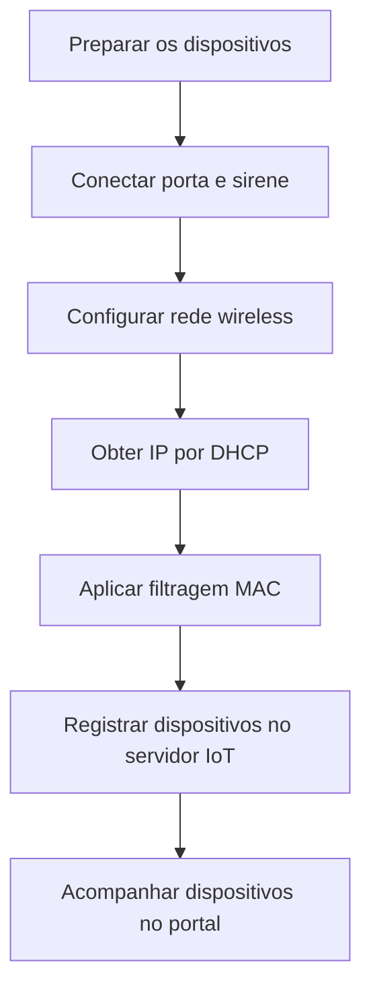

# Segurança física com dispositivos IoT

## Visão geral

Neste laboratório da Cisco Networking Academy (NetAcad), utilizei o **Cisco Packet Tracer** para simular o monitoramento de uma residência com dispositivos inteligentes (IoT).

A atividade envolveu conectar portas, sirene, sensor de movimento e webcam a uma rede wireless, configurar medidas de segurança e acompanhar os dispositivos por meio de um servidor IoT.

---

## Objetivos

- Conectar dispositivos IoT a uma rede wireless protegida.
- Configurar WPA2-PSK e filtragem de endereços MAC.
- Utilizar DHCP para obter endereços IP automaticamente.
- Integrar portas e sirene por uma conexão digital.
- Acompanhar os equipamentos em um servidor IoT.

---

## Configurações realizadas

### 1. Rede wireless e segurança

O roteador conecta os dispositivos à rede e controla quais equipamentos podem acessá-la.

| Parâmetro | Configuração |
|---|---|
| SSID | `HomeNet` |
| Frequência | 2,4 GHz |
| Autenticação | WPA2-PSK |
| Criptografia dos dispositivos | AES |
| Rede IPv4 | `192.168.0.0/24` |
| IP do roteador | `192.168.0.1` |
| Distribuição de IP | DHCP |
| Filtragem MAC | Habilitada |
| Política de acesso | Permitir somente endereços cadastrados |

**Importante:** a filtragem MAC ajuda a controlar os dispositivos autorizados, mas não substitui a proteção WPA2, pois endereços MAC podem ser falsificados.

### 2. Dispositivos IoT

Todos os dispositivos abaixo foram configurados para utilizar a rede `HomeNet`, com autenticação WPA2-PSK e endereçamento automático por DHCP.

| Dispositivo | Endereço MAC | Função |
|---|---|---|
| Home_Siren | `00:90:2B:C8:C6:E2` | Sinalizar eventos por meio de uma sirene. |
| Home_Doors | `00:0A:F3:DB:2E:37` | Representar a abertura e o fechamento das portas. |
| Home_Motion_Sensor | `00:40:0B:39:21:24` | Detectar movimentos no ambiente. |
| Home_Webcam | `00:D0:58:D1:C4:11` | Permitir a visualização do ambiente. |

**Configurações adicionais:**

- **Home_Siren:** interface `Wireless0`, endereço IPv4 `192.168.0.104` e máscara `255.255.255.0`.
- **Home_Siren e Home_Doors:** conexão pela interface digital `D0`, utilizada para simular uma resposta à abertura da porta.

### 3. Servidor de monitoramento IoT

O servidor reúne os dispositivos em uma interface de acompanhamento.

| Parâmetro | Configuração |
|---|---|
| Serviço | IoT Registration Server |
| Endereço IP | `10.3.0.125` |
| Dispositivos | Sirene, portas, sensor de movimento e webcam |
| Recursos | Consulta dos estados dos dispositivos e visualização da webcam |

---

## Etapas do laboratório

1. **Preparação:** organizar os dispositivos no ambiente residencial simulado.
2. **Integração:** conectar a porta e a sirene pela interface digital `D0`.
3. **Conectividade:** configurar os dispositivos na rede wireless `HomeNet`.
4. **Endereçamento:** utilizar DHCP para receber as configurações IPv4.
5. **Segurança:** habilitar a filtragem MAC e cadastrar os dispositivos autorizados.
6. **Monitoramento:** registrar e consultar os equipamentos no servidor IoT.

### Fluxo das configurações

### Acompanhamento no portal IoT

O portal permite consultar os estados da sirene, das portas e do sensor de movimento, além de visualizar a imagem da webcam.

---

## Onde esse conhecimento pode ser aplicado?

### Cenário fictício: monitoramento de uma residência durante uma viagem

**Situação:** uma família vai viajar e deseja acompanhar a segurança da casa enquanto está fora.

**Solução:** a residência conta com uma câmera para observar o ambiente, um sensor para identificar movimentos e uma porta conectada a uma sirene para sinalizar uma possível abertura.

**Benefício:** os moradores podem acompanhar diferentes equipamentos em um único sistema, facilitando o monitoramento da residência.

*Este é um exemplo de aplicação dos conceitos estudados, não um teste adicional realizado no laboratório.*

---

## Conhecimentos adquiridos

| Conhecimento | O que aprendi |
|---|---|
| Redes wireless | Como conectar diferentes dispositivos à mesma rede. |
| WPA2-PSK e AES | Como proteger a autenticação e a comunicação wireless. |
| Filtragem MAC | Como criar uma lista de dispositivos autorizados. |
| DHCP | Como distribuir configurações de rede automaticamente. |
| Integração IoT | Como dispositivos podem interagir e responder a eventos. |
| Monitoramento | Como acompanhar equipamentos por meio de um servidor IoT. |

### Relação com Suporte de TI e Cybersecurity

O laboratório reforçou conhecimentos importantes para identificar dispositivos conectados, investigar problemas de comunicação e compreender controles de acesso.

Também mostrou a importância de proteger redes que utilizam dispositivos inteligentes e acompanhar seu funcionamento.

---

## Entendendo os termos técnicos

| Termo | Explicação simples |
|---|---|
| IoT | Dispositivos inteligentes conectados à rede, como câmeras e sensores. |
| SSID | Nome da rede wireless, como `HomeNet`. |
| WPA2-PSK | Proteção que utiliza uma senha compartilhada para conectar dispositivos à rede. |
| AES | Tecnologia que criptografa informações para dificultar acessos indevidos aos dados. |
| DHCP | Serviço que fornece automaticamente endereços IP e outras configurações de rede. |
| Endereço IP | Identificação utilizada para a comunicação de um dispositivo na rede. |
| Endereço MAC | Identificador de uma interface de rede. |
| Filtragem MAC | Controle que permite ou bloqueia dispositivos conforme uma lista de endereços. |
| Interface D0 | Conexão digital utilizada para trocar sinais entre dispositivos no laboratório. |
| Servidor IoT | Sistema utilizado para registrar e acompanhar dispositivos inteligentes. |
  
