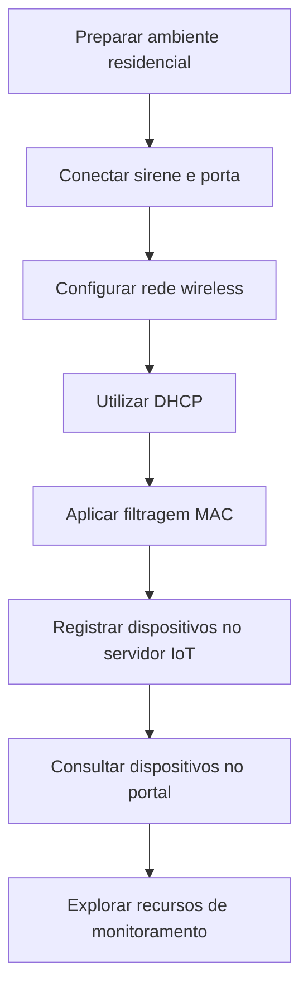

# Segurança física com dispositivos IoT

## Visão geral

Neste laboratório educacional da Cisco Networking Academy (NetAcad), utilizei o Cisco Packet Tracer para conhecer como dispositivos inteligentes podem ajudar a monitorar uma residência.

A atividade envolveu conectar sirene, portas, sensor de movimento e webcam à rede wireless, configurar o controle de acesso por endereço MAC e acompanhar os equipamentos em um servidor IoT.

---

## Objetivos

- Conectar dispositivos IoT a uma rede wireless protegida.
- Configurar autenticação WPA2-PSK e filtragem MAC.
- Utilizar DHCP para obter endereços IP automaticamente.
- Acompanhar os dispositivos por meio de um servidor IoT.
- Entender como portas, sensores, câmeras e sirenes podem contribuir para o monitoramento.

---

## Etapas do laboratório

1. **Conexão IoT:** ligação entre porta e sirene pela interface digital `D0`, permitindo simular uma resposta à abertura da porta.
2. **Rede wireless:** configuração dos dispositivos para utilizar a rede `HomeNet` com autenticação WPA2-PSK.
3. **Endereçamento:** utilização de DHCP para receber automaticamente as configurações IPv4.
4. **Controle de acesso:** habilitação da filtragem MAC no roteador, permitindo apenas endereços cadastrados.
5. **Monitoramento:** registro e consulta dos dispositivos no servidor IoT.

---

## Fluxograma do processo

---

## Onde esse conhecimento pode ser aplicado?

### Cenário fictício: casa monitorada durante uma viagem

**Situação:** uma família vai viajar e quer acompanhar a entrada da residência enquanto está fora.

**Aplicação:** uma câmera permite observar o ambiente, o sensor informa a presença de movimento e a porta pode ser associada a uma sirene para sinalizar uma abertura. Os equipamentos ficam disponíveis em um sistema de monitoramento.

**Benefício:** a família consegue acompanhar diferentes dispositivos em um só lugar. O exemplo utiliza os mesmos conceitos de conectividade, integração e monitoramento estudados no laboratório; não representa um teste adicional realizado.

---

## Configurações dos dispositivos

### Roteador wireless

Responsável pela conexão wireless e pelo controle dos equipamentos autorizados.

| Parâmetro | Configuração |
|---|---|
| SSID | `HomeNet` |
| Frequência | 2,4 GHz |
| Autenticação | WPA2-PSK |
| Rede IPv4 | `192.168.0.0/24` |
| Endereço de gerenciamento | `192.168.0.1` |
| Filtragem MAC | Habilitada |
| Política de acesso | Permitir somente endereços MAC cadastrados |

A filtragem MAC adiciona um controle de acesso, mas não substitui a autenticação e a criptografia da rede, pois endereços MAC podem ser falsificados.

---

### Home_Siren (sirene)

| Parâmetro | Configuração |
|---|---|
| Interface | `Wireless0` |
| SSID | `HomeNet` |
| Autenticação | WPA2-PSK |
| Criptografia | AES |
| Endereço MAC | `00:90:2B:C8:C6:E2` |
| Configuração IPv4 | DHCP |
| Endereço IPv4 | `192.168.0.104` |
| Máscara | `255.255.255.0` |
| Conexão IoT | Interface digital `D0` |

A sirene pode ser ligada à porta para simular um alerta quando ela é aberta.

---

### Home_Doors (portas)

| Parâmetro | Configuração |
|---|---|
| SSID | `HomeNet` |
| Autenticação | WPA2-PSK |
| Endereço MAC | `00:0A:F3:DB:2E:37` |
| Configuração IPv4 | DHCP |
| Conexão IoT | Interface digital `D0` |

As portas representam eventos de abertura e fechamento e podem interagir com a sirene.

---

### Home_Motion_Sensor (sensor de movimento)

| Parâmetro | Configuração |
|---|---|
| SSID | `HomeNet` |
| Autenticação | WPA2-PSK |
| Endereço MAC | `00:40:0B:39:21:24` |
| Configuração IPv4 | DHCP |

O sensor identifica movimento e permite acompanhar seu estado no sistema IoT.

---

### Home_Webcam (câmera)

| Parâmetro | Configuração |
|---|---|
| SSID | `HomeNet` |
| Autenticação | WPA2-PSK |
| Endereço MAC | `00:D0:58:D1:C4:11` |
| Configuração IPv4 | DHCP |

A webcam permite visualizar imagens do ambiente pelo portal IoT.

---

### Servidor de registro IoT

| Parâmetro | Configuração |
|---|---|
| Serviço | IoT Registration Server |
| Endereço IP | `10.3.0.125` |
| Dispositivos apresentados | Sirene, portas, sensor de movimento e webcam |
| Funcionalidades | Visualização de estados e imagens da webcam |

O servidor reúne o acompanhamento dos dispositivos em uma interface.

---

### Endereços MAC identificados

| Dispositivo | Endereço MAC |
|---|---|
| Home_Siren | `00:90:2B:C8:C6:E2` |
| Home_Doors | `00:0A:F3:DB:2E:37` |
| Home_Motion_Sensor | `00:40:0B:39:21:24` |
| Home_Webcam | `00:D0:58:D1:C4:11` |

---

### Acompanhamento no portal IoT

O portal apresenta os estados da sirene, das portas e do sensor de movimento, além da imagem da webcam.

---

## Conhecimentos adquiridos

- **Conectividade wireless:** compreendi como diferentes dispositivos podem utilizar a mesma rede.
- **Controle de acesso:** estudei a autenticação WPA2-PSK e a filtragem MAC como medidas de segurança.
- **Endereçamento IP:** observei como o DHCP facilita a configuração dos dispositivos.
- **Monitoramento IoT:** conheci uma interface para acompanhar sensores, portas, sirenes e câmeras.
- **Integração:** entendi como a ligação entre dispositivos pode permitir respostas a eventos.

---

### Relação com Suporte de TI e Cybersecurity

Os conceitos também são úteis para identificar equipamentos conectados, investigar falhas de conectividade e compreender controles de acesso. O laboratório reforça a importância de conhecer os dispositivos de uma rede e aplicar medidas de segurança complementares.

---

## Entendendo os termos técnicos

| Termo | Explicação simples |
|---|---|
| IoT | Objetos conectados à rede, como câmeras e sensores inteligentes. |
| SSID | Nome que identifica uma rede wireless, como `HomeNet`. |
| WPA2-PSK | Proteção que usa uma senha compartilhada para autenticar dispositivos na rede wireless. |
| AES | Tecnologia usada para criptografar dados, dificultando sua leitura por terceiros. |
| DHCP | Serviço que distribui automaticamente configurações de rede, como endereços IP. |
| Endereço IP | Identificação usada para a comunicação de um dispositivo na rede. |
| Endereço MAC | Identificador de uma interface de rede, usado neste laboratório na lista de acesso. |
| Filtragem MAC | Regra que permite ou bloqueia conexões conforme os endereços MAC cadastrados. |
