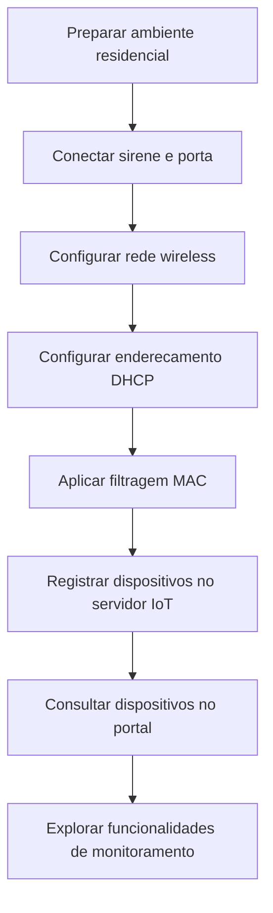

# Laboratório da Cisco Networking Academy Segurança física com dispositivos IoT

## Visão geral

Utilizei o Cisco Packet Tracer para aprender como dispositivos inteligentes podem ajudar a monitorar a segurança de uma residência.

A atividade envolveu conectar uma sirene, portas, um sensor de movimento e uma webcam à rede wireless, configurar o controle de acesso por endereço MAC e acompanhar os dispositivos por meio de um servidor IoT.

---

## Objetivos

- Conectar dispositivos IoT a uma rede wireless protegida.
- Configurar a filtragem MAC para controlar o acesso à rede.
- Registrar dispositivos em um servidor IoT.
- Entender como sensores, sirenes e câmeras ajudam no monitoramento de ambientes.

---

## Configurações dos dispositivos

### 1. Roteador wireless

Responsável pela conexão dos dispositivos IoT e pelo controle de quais equipamentos podem acessar a rede.

| Parâmetro | Configuração |
|---|---|
| SSID | `HomeNet` |
| Frequência | 2,4 GHz |
| Autenticação | WPA2-PSK |
| Rede IPv4 | `192.168.0.0/24` |
| Endereço de gerenciamento | `192.168.0.1` |
| Filtragem MAC | Habilitada |
| Política de acesso | Permitir somente endereços MAC cadastrados |

**Como funciona:** o roteador utiliza a autenticação wireless e uma lista de endereços MAC autorizados para controlar a conexão dos dispositivos.

A filtragem MAC oferece um controle adicional, mas não substitui a autenticação e a criptografia da rede.

---

### 2. Home_Siren (sirene)

Dispositivo utilizado para emitir um alerta sonoro quando acionado por um evento.

| Parâmetro | Configuração |
|---|---|
| Dispositivo | `Home_Siren` |
| Interface | `Wireless0` |
| SSID | `HomeNet` |
| Autenticação | WPA2-PSK |
| Criptografia | AES |
| Endereço MAC | `00:90:2B:C8:C6:E2` |
| Configuração IPv4 | DHCP |
| Endereço IPv4 | `192.168.0.104` |
| Máscara de sub-rede | `255.255.255.0` |
| Conexão IoT | Interface digital `D0` |

**Como funciona:** a sirene pode ser associada à porta para emitir um alerta quando ocorrer uma abertura.

---

### 3. Home_Doors (portas)

Dispositivo que representa a abertura e o fechamento das portas da residência.

| Parâmetro | Configuração |
|---|---|
| Dispositivo | `Home_Doors` |
| SSID | `HomeNet` |
| Autenticação | WPA2-PSK |
| Endereço MAC | `00:0A:F3:DB:2E:37` |
| Configuração IPv4 | DHCP |
| Conexão IoT | Interface digital `D0` |

**Como funciona:** a porta pode ser conectada à sirene, permitindo simular um alerta quando ela é aberta.

---

### 4. Home_Motion_Sensor (sensor de movimento)

Dispositivo responsável por identificar movimentos no ambiente.

| Parâmetro | Configuração |
|---|---|
| Dispositivo | `Home_Motion_Sensor` |
| SSID | `HomeNet` |
| Autenticação | WPA2-PSK |
| Endereço MAC | `00:40:0B:39:21:24` |
| Configuração IPv4 | DHCP |

**Como funciona:** o sensor identifica movimentos e permite acompanhar seu estado pelo sistema de monitoramento IoT.

---

### 5. Home_Webcam (câmera)

Dispositivo utilizado para visualizar imagens do ambiente residencial.

| Parâmetro | Configuração |
|---|---|
| Dispositivo | `Home_Webcam` |
| SSID | `HomeNet` |
| Autenticação | WPA2-PSK |
| Endereço MAC | `00:D0:58:D1:C4:11` |
| Configuração IPv4 | DHCP |

**Como funciona:** a webcam permite visualizar imagens do ambiente pelo portal IoT, ajudando no acompanhamento remoto da residência.

---

### 6. Servidor de registro IoT

Responsável por centralizar o acesso e o monitoramento dos dispositivos inteligentes.

| Parâmetro | Configuração |
|---|---|
| Serviço | IoT Registration Server |
| Endereço IP | `10.3.0.125` |
| Dispositivos apresentados | Sirene, portas, sensor de movimento e webcam |
| Funcionalidades | Visualização de estados e imagens da webcam |

**Como funciona:** os dispositivos são registrados no servidor para que possam ser acompanhados em uma única interface.

---

## Etapas do laboratório

### 1. Conexão dos dispositivos

No ambiente residencial do Packet Tracer, foi utilizada uma conexão IoT entre a sirene e a porta.

Essa ligação permite simular o acionamento de um alerta quando a porta é aberta.

### 2. Configuração da rede wireless

Os dispositivos IoT foram configurados para utilizar a rede `HomeNet`, com autenticação WPA2-PSK e endereçamento automático por DHCP.

O DHCP permite que os equipamentos recebam seus endereços IP automaticamente, facilitando a conexão à rede.

### 3. Controle de acesso por MAC

O roteador utiliza uma lista de endereços MAC autorizados.

Foram identificados os seguintes dispositivos:

| Dispositivo | Endereço MAC |
|---|---|
| Home_Siren | `00:90:2B:C8:C6:E2` |
| Home_Doors | `00:0A:F3:DB:2E:37` |
| Home_Motion_Sensor | `00:40:0B:39:21:24` |
| Home_Webcam | `00:D0:58:D1:C4:11` |

Esse recurso permite controlar quais dispositivos podem utilizar a rede wireless.

**Importante:** endereços MAC podem ser falsificados. Por isso, a filtragem deve ser utilizada como uma medida complementar de segurança.

---

### 4. Monitoramento remoto

O servidor IoT permite acompanhar os dispositivos conectados por meio de uma interface web.

No portal do laboratório, são apresentados:

- Estado da sirene.
- Estado das portas.
- Estado do sensor de movimento.
- Imagem da webcam.

Isso permite compreender como diferentes equipamentos podem ser acompanhados em um único sistema.

---

## Fluxograma do processo

## Funcionalidades estudadas

| Recurso | Finalidade |
|---|---|
| Sirene | Emitir alertas sonoros |
| Portas | Simular abertura e fechamento |
| Sensor de movimento | Identificar movimentos no ambiente |
| Webcam | Permitir visualização remota |
| Filtragem MAC | Controlar dispositivos autorizados |
| Servidor IoT | Centralizar o monitoramento |

---

## Conhecimentos adquiridos

Este laboratório ajudou a compreender como dispositivos IoT podem ser utilizados para melhorar o monitoramento e a segurança física de uma residência.

Os principais aprendizados foram:

- **Conectividade wireless:** entender como diferentes dispositivos se conectam à mesma rede.
- **Segurança de acesso:** compreender o funcionamento da autenticação WPA2-PSK e da filtragem MAC.
- **Endereçamento IP:** entender como o DHCP facilita a configuração dos equipamentos.
- **Monitoramento IoT:** conhecer como sensores, câmeras e sirenes podem ser acompanhados remotamente.
- **Integração de dispositivos:** compreender como equipamentos podem interagir para responder a eventos.

---

### Relação com Suporte de TI e Cybersecurity

Os conceitos estudados também estão presentes em ambientes profissionais, principalmente na identificação de dispositivos, configuração de redes, controle de acesso e investigação de problemas de conectividade.

A atividade reforçou a importância de conhecer os equipamentos conectados à rede e utilizar diferentes medidas de segurança para reduzir acessos não autorizados.

Laboratório educacional realizado no Cisco Packet Tracer, com documentação própria dos conceitos e configurações estudados.

